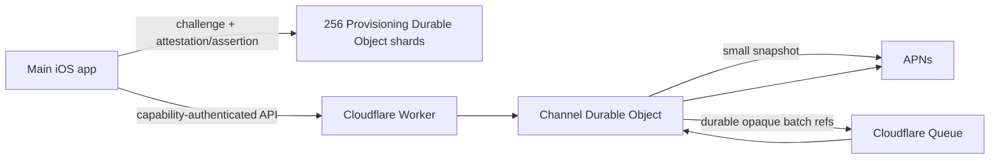

# APNW

APNW is a capability-authenticated APNs provider for native Apple apps. It
sends a server-controlled fallback alert plus a versioned envelope containing
an app-defined event name and JSON data. Applications can use opaque local
identifiers or end-to-end encrypted values when their domain data must remain
hidden from Cloudflare and APNs.

This implementation includes:

- Apple App Attest key registration, signed DeviceCheck fraud-receipt
  assessment, and assertion-gated channel provisioning.
- Separate 256-bit channel, channel-administrator, and installation
  capabilities.
- Stable, domain-separated channel routing that survives unrelated secret
  rotation.
- Per-channel SQLite Durable Objects with permanent closure tombstones.
- UUIDv4/time-bound event idempotency retained for seven days.
- Direct delivery for small snapshots and Durable Object outbox plus Cloudflare
  Queue delivery for larger snapshots.
- No device-count, user-count, channel-count, or service-wide throughput
  ceiling.
- APNs token-version snapshots, timestamp-safe `410` cleanup, repeated
  `BadDeviceToken` quarantine, and APNs cleanup/delivery circuit breakers.
- Separate development and production APNs/App Attest environments.
- Privacy-reviewed logs, aggregate Analytics Engine metrics, and production
  invocation logging disabled.

## Trust model

Channel provisioning is the only operation that creates live channel state. It
requires a registered App Attest key, a fresh five-minute server challenge, a
valid assertion, and a strictly increasing assertion counter.

After provisioning:

- The shared channel capability authorizes event publication and first
  installation registration.
- The installation capability authorizes updates, removal, and sender
  exclusion for exactly one installation.
- The administrator capability authorizes irreversible channel closure.

All three capabilities are independent, canonical unpadded base64url encodings
of exactly 32 random bytes. Raw capabilities are never stored or logged.

App Attest proves that provisioning came from an allowed instance of the
configured app. It is not user identity, does not prove collaboration
membership, and does not prevent an authorized participant from deliberately
sharing a capability. Capability distribution and membership remain the app's
responsibility.

Key registration exchanges Apple's untrusted attestation receipt for a signed
risk receipt, verifies its chain, App ID, public key, age, and metric, and
refreshes it after Apple's `notBefore` time. A known metric above the checked-in
app threshold blocks provisioning. Apple or network unavailability is retried
with bounded backoff and does not create a service-wide availability ceiling.

## Architecture



One channel never serializes unrelated channels. Provisioning traffic is
distributed across 256 stable per-app shards. Queue consumers are deliberately
left without a fixed maximum concurrency so Cloudflare can scale them across
independent channels.

Queue messages contain only app ID, Durable Object ID, event UUID, and batch
number. APNs tokens never leave their Channel Durable Object except in the
fixed outbound request to Apple.

## Repository guide

- [Plan.md](Plan.md) — accepted architecture and security requirements.
- [docs/api.md](docs/api.md) — exact API and canonical App Attest binding.
- [docs/ios-integration.md](docs/ios-integration.md) — main-app, Keychain,
  CloudKit, APNs, and outbox integration.
- [docs/security.md](docs/security.md) — threat model, invariants, and residual
  risks.
- [docs/deployment.md](docs/deployment.md) — environment setup, queues, secrets,
  custom domains, smoke tests, and rollback.
- [docs/observability.md](docs/observability.md) — privacy boundary and incident
  runbook.
- `src/apps.ts` — bundle IDs, App Attest policy, shard version, and generic
  fallback alerts.
- `src/appattest/` — bounded CBOR/authenticator and ASN.1 receipt parsing, X.509
  and PKCS#7 verification, challenges, key state, fraud policy, and assertion
  counters.
- `src/channel/` — registration, idempotency, outbox, delivery, cleanup, and
  tombstones.

## Local setup

Requirements are Node.js 22 or newer and a Cloudflare account supporting
SQLite Durable Objects, Queues, and Analytics Engine.

```bash
npm install
cp .dev.vars.example .dev.vars
npm run check
npm run dev
```

Populate `.dev.vars` with development-only credentials. Never install
production APNs or DeviceCheck private keys in the development Worker.

Generate each server secret or application capability from 32 random bytes:

```bash
openssl rand -base64 32 | tr '+/' '-_' | tr -d '='
```

`LOG_CORRELATION_KEY` is used only to produce daily rotating, 16-hex-character
operational channel references. It does not affect Durable Object routing.

## App registry

Every app is explicit in `src/apps.ts`:

```ts
chain_of_custody: {
  bundleID: "com.twodayslate.coc",
  appAttest: {
    extensionPolicy: "if-present",
    allowedValidationCategories: {
      development: [3],
      production: [2, 4],
    },
  },
  provisioning: { shardCount: 256, shardVersion: 1 },
  notificationFallback: {
    title: "Chain of Custody",
    body: "You have a new update.",
  },
}
```

Every valid `CFBundleVersion` is accepted. Move `extensionPolicy` to `required`
only after the minimum supported OS always emits the Apple distribution
extensions.

The fallback alert must remain generic. Publishers may supply an event name and
arbitrary JSON object under `data`; APNW places both inside its reserved `apnw`
envelope and never allows a publisher to replace the Apple-reserved `aps`
dictionary. The complete APNs payload is limited to 4,096 bytes.

## Verification

```bash
npm run check
npx wrangler deploy --dry-run
```

The Worker-runtime suite covers:

- strict capability/header/body parsing and opaque failures;
- App Attest chain, nonce, key, RP ID, AAGUID, environment, assertion signature,
  counter, distribution-extension, and fraud-receipt parsing checks;
- authorization separation for installation churn, sender exclusion, and
  closure;
- seven-day idempotency behavior, canonical app-data binding, and count-free
  responses;
- more than 40 recipients and multi-batch queue partitioning;
- APNs environment fail-closed behavior, safe reason mapping, timestamp cleanup,
  repeated-token quarantine, and token-rotation races;
- telemetry privacy and failure isolation.

Tests use generated certificates and a test APNs key and do not contact Apple.

## Production

Production has `workers_dev: false`; configure an explicit custom domain before
deploying. Development and production use separate Durable Object namespaces,
queues, dead-letter queues, analytics datasets, APNs keys, DeviceCheck keys, and
App Attest environments.

Follow [docs/deployment.md](docs/deployment.md). A production release is not
complete until physical-device development and TestFlight flows both pass,
queue/DLQ monitoring is active, and `/health` reports the intended environment
and release version.
